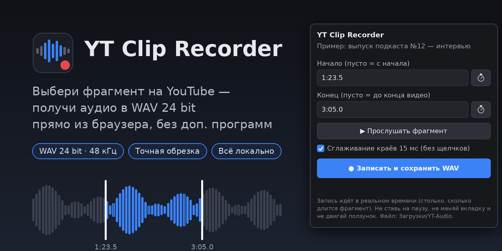
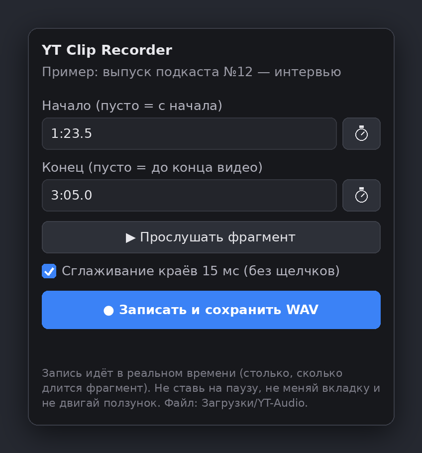
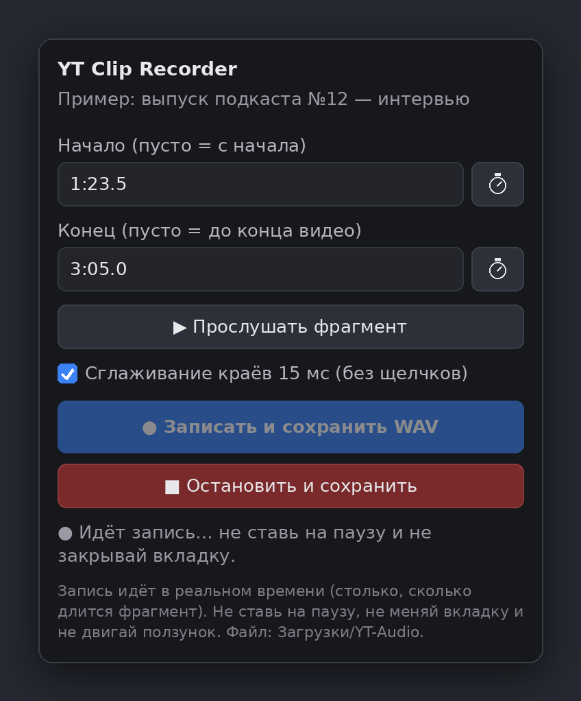
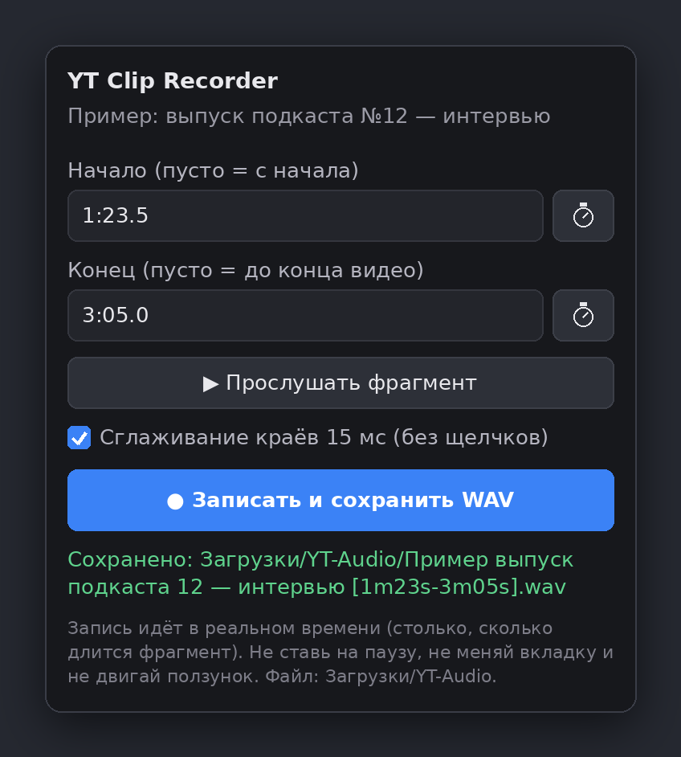
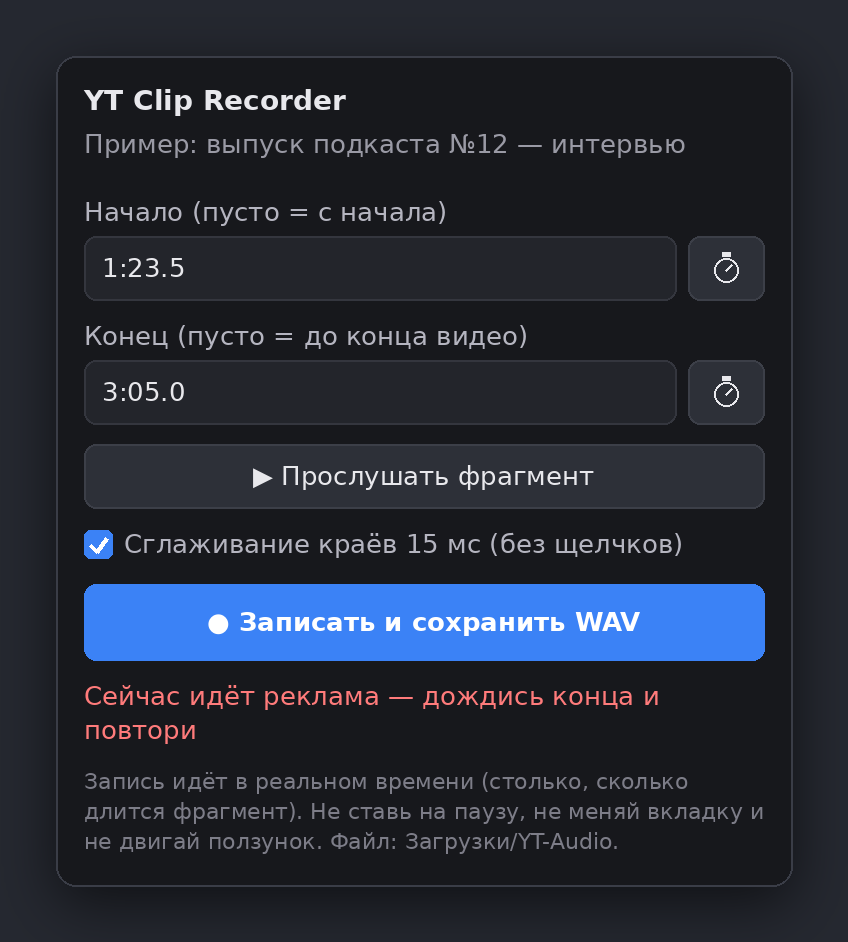
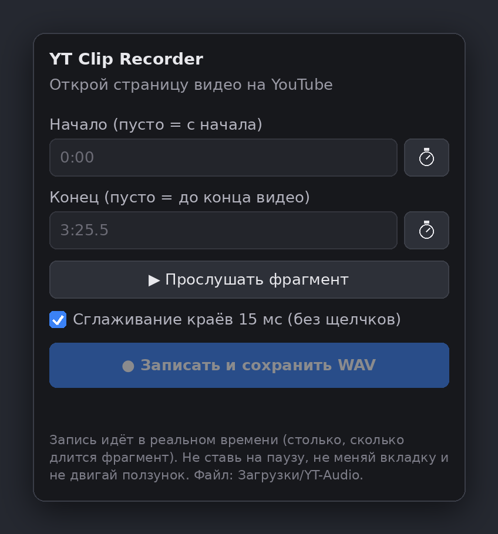
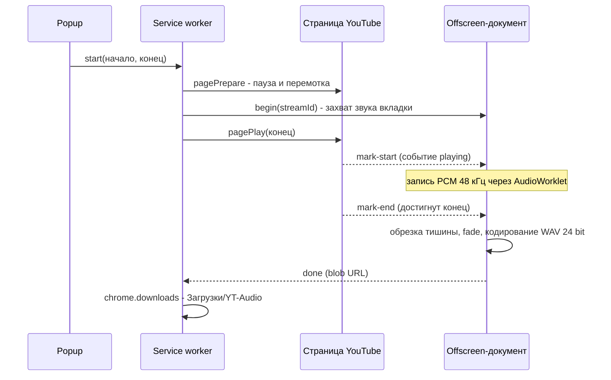

<div align="center">



# YT Clip Recorder

**Расширение для Chromium-браузеров: выбираешь фрагмент видео на YouTube — получаешь аудио в WAV 24 bit.**
Без Python, `yt-dlp`, `ffmpeg` и любых внешних программ.


</div>

<!-- Изображения в docs/ — иллюстрации интерфейса. Позже можно заменить их настоящими скриншотами с теми же именами файлов. -->

---

## Содержание

- [Возможности](#возможности)
- [Скриншоты](#скриншоты)
- [Установка](#установка)
- [Как пользоваться](#как-пользоваться)
- [Как это работает](#как-это-работает)
- [Качество звука](#качество-звука)
- [Разрешения](#разрешения)
- [Приватность](#приватность)
- [Ограничения и частые проблемы](#ограничения-и-частые-проблемы)
- [Структура проекта](#структура-проекта)
- [Разработка и тесты](#разработка-и-тесты)
- [Дорожная карта](#дорожная-карта)
- [Правовая информация](#правовая-информация)
- [Лицензия](#лицензия)

## Возможности

- **Фрагмент по времени.** Начало и конец можно вписать вручную (`1:23.5`, `83`, `1:02:03`) или взять кнопкой ⏱ с текущей позиции плеера.
- **Прослушивание до записи.** Кнопка «Прослушать фрагмент» проигрывает выбранный отрезок прямо в плеере.
- **Максимальное качество из доступного.** Стерео, 48 кГц, WAV 24 bit; без ресемплинга и без дополнительного lossy-сжатия.
- **Точная длина.** Тишина в начале отрезается по первому звуку, длина записи выставляется по заданным границам.
- **Сглаживание краёв (15 мс).** Убирает щелчки на стыках; отключается галочкой.
- **Запись не зависит от окна расширения.** Работает через offscreen-документ и service worker: окно popup можно закрыть.
- **Кнопка «Остановить и сохранить».** Если фрагмент без конца — остановишь, когда захочешь.
- **Индикатор на иконке:** `REC` — запись, `...` — обработка, `OK` — готово, `ERR` — ошибка.
- **Ноль зависимостей.** Чистый JavaScript, никакой сборки.
- **Всё локально.** Ни серверов, ни аналитики, ни сетевых запросов с вашей стороны.

## Скриншоты

| Выбор фрагмента | Идёт запись |
|:---:|:---:|
|  |  |

| Файл сохранён | Ошибка: реклама |
|:---:|:---:|
|  |  |

| Не страница YouTube |
|:---:|
|  |

## Установка

**Требования:** браузер на базе Chromium версии **116 или новее** (Chrome; Edge и Brave должны работать, но не проверялись).

1. Скачай проект: **Code → Download ZIP** "https://github.com/INTROLMMORTAL/yt-clip-recorder/archive/refs/heads/main.zip" на странице репозитория (или `git clone`) и распакуй.
2. Открой `chrome://extensions`.
3. Включи **«Режим разработчика»** (справа вверху).
4. Нажми **«Загрузить распакованное»** и выбери папку, в которой лежит `manifest.json`.
5. Закрепи иконку: значок пазла → булавка рядом с **YT Clip Recorder**.

**Обновление:** замени файлы в папке, затем на странице `chrome://extensions` нажми ⟳ у расширения.

> Chrome может изредка напоминать, что включены расширения в режиме разработчика. Это нормально для расширений, установленных не из магазина.

## Как пользоваться

1. Открой видео на `youtube.com` (или `music.youtube.com`) и дождись, пока пройдёт реклама.
2. Нажми на иконку расширения.
3. Задай **начало** и **конец** фрагмента. Быстрый способ: поставь видео на нужный момент и нажми ⏱ у соответствующего поля.
4. Проверь фрагмент кнопкой **«▶ Прослушать фрагмент»**.
5. Нажми **«● Записать и сохранить WAV»**. Видео автоматически перемотается на начало и запишется в реальном времени.
6. Дождись значка `OK` на иконке. Файл появится в **Загрузки/YT-Audio**.

Пустое «Начало» — с начала видео, пустой «Конец» — до конца видео.

**Пока идёт запись:** не ставь видео на паузу, не двигай ползунок, не закрывай вкладку и не переключайся на другую.

Имя файла: `Название видео [1m23s-3m05s].wav`.

## Как это работает

Прямое скачивание потоков YouTube требует внешних инструментов, которые нужно постоянно обновлять. Поэтому расширение делает иначе: **записывает уже декодированный звук вкладки**, пока воспроизводится выбранный фрагмент.



Почему так устроено:

- `chrome.tabCapture` даёт поток звука вкладки, а `AudioWorklet` забирает из него сэмплы блоками по 512 кадров.
- Захват живёт в **offscreen-документе**, потому что service worker в Manifest V3 не может держать аудиоконтекст, а popup закрывается при потере фокуса.
- Страничные скрипты (`pagePrepare`, `pagePlay`, `pagePause`) внедряются через `chrome.scripting` и сообщают о начале и конце фрагмента сообщениями `mark-start` / `mark-end`.
- Service worker не ждёт запись «в долгом вызове»: он просыпается только по сообщениям, поэтому его остановка по таймеру Chrome не ломает запись.

## Качество звука

| Этап | Что происходит |
|---|---|
| Источник | Звук, который плеер YouTube выбрал для воспроизведения (обычно Opus, около 160 kbps; бывает AAC) |
| Захват | Декодированный сигнал, float, 48 кГц, стерео; контекст создаётся на 48 кГц, ресемплинга нет |
| Обработка | Обрезка цифровой тишины в начале, точная длина, опциональный fade 15 мс |
| Выход | WAV PCM 24 bit, 48 кГц, стерео; без дизеринга и нормализации |

Что важно знать честно:

- Это **запись воспроизведения**, а не копия исходного файла. Формат потока выбирает плеер, повлиять на это расширение не может.
- 24 bit не добавляют качества сверх источника: они нужны, чтобы не терять точность при дальнейшей обработке.
- WAV много весит: около 17 МБ на минуту. Для MP3 или FLAC открой файл в любом аудиоредакторе (например, Audacity).
- Точность границ фрагмента около ±0,1 с.

## Разрешения

| Разрешение | Зачем |
|---|---|
| `activeTab` | Доступ к текущей вкладке после клика по иконке |
| `scripting` | Перемотка, запуск и остановка видео на странице |
| `tabCapture` | Захват звука вкладки |
| `offscreen` | Скрытый документ, в котором идёт запись |
| `downloads` | Сохранение WAV в `Загрузки/YT-Audio` |
| `storage` | Состояние записи (хранится во временной сессионной памяти) |
| `youtube.com`, `music.youtube.com` | Работа со страницами видео |

## Приватность

Расширение ничего не отправляет в сеть: нет серверов, аналитики и учётных записей. Записанный звук обрабатывается в памяти браузера и сохраняется только в вашу папку загрузок.

## Ограничения и частые проблемы

| Проблема | Что делать |
|---|---|
| «Сейчас идёт реклама» | Дождись конца рекламы и повтори |
| «Записана тишина» / «Ничего не записано» | Проверь, что звук вкладки не отключён (значок динамика на вкладке) и видео действительно играло |
| Запись остановилась раньше | Не ставь на паузу и не двигай ползунок во время записи; оставайся на вкладке |
| В начале или конце лишние доли секунды | Допуск ±0,1 с; подкорректируй границы на 0,1–0,2 с |
| Кнопки неактивны | Расширение работает только на страницах `youtube.com/watch…` и `/shorts…` |
| Ничего не происходит после установки | Обнови Chrome до 116+, перезагрузи вкладку YouTube |
| Очень длинное видео | Запись идёт в памяти; для треков длиннее 10 минут лучше записывать по частям |

## Структура проекта

```
yt-clip-recorder/
├── manifest.json            # манифест (MV3)
├── background.js            # service worker: сценарий записи, скачивание, состояние
├── popup.html / popup.js    # окно расширения
├── offscreen.html / .js     # захват звука, обрезка, кодирование
├── recorder-worklet.js      # AudioWorklet: сбор сэмплов
├── wav.js                   # чистые функции: поиск начала, fade, WAV 24 bit
├── icons/                   # иконки 16/48/128
├── docs/                    # баннер и скриншоты для README
├── tests/wav.test.js        # тесты обработки звука
├── CHANGELOG.md
├── LICENSE
└── README.md
```

## Разработка и тесты

Сборки нет: правишь файлы и нажимаешь ⟳ на `chrome://extensions`.

- Логи service worker: `chrome://extensions` → **Service worker** у расширения.
- Логи offscreen-документа: там же, ссылка **offscreen.html** в списке «Проверить представления».
- Тесты обработки звука (нужен Node.js 18+):

```bash
node tests/wav.test.js
```

## Дорожная карта

- [ ] Экспорт в FLAC и MP3 прямо в расширении
- [ ] Редактор с волной: перетаскиваемые границы фрагмента
- [ ] Очередь из нескольких фрагментов одного видео
- [ ] Горячие клавиши для отметок начала и конца
- [ ] Английская локализация
- [ ] Проверка в Edge, Brave и Opera

## Правовая информация

Проект предназначен для **личного использования**. Запись и сохранение материалов с YouTube может нарушать [Условия использования YouTube](https://www.youtube.com/t/terms), а многие записи защищены авторским правом. Ответственность за то, что и как записывать, лежит на пользователе. Используй расширение для собственного контента, материалов с разрешением автора и лицензий, которые это допускают. Проект не связан с YouTube и Google. Расширение не принимается в Chrome Web Store, поэтому устанавливается только вручную.

## Лицензия

[MIT](LICENSE)
